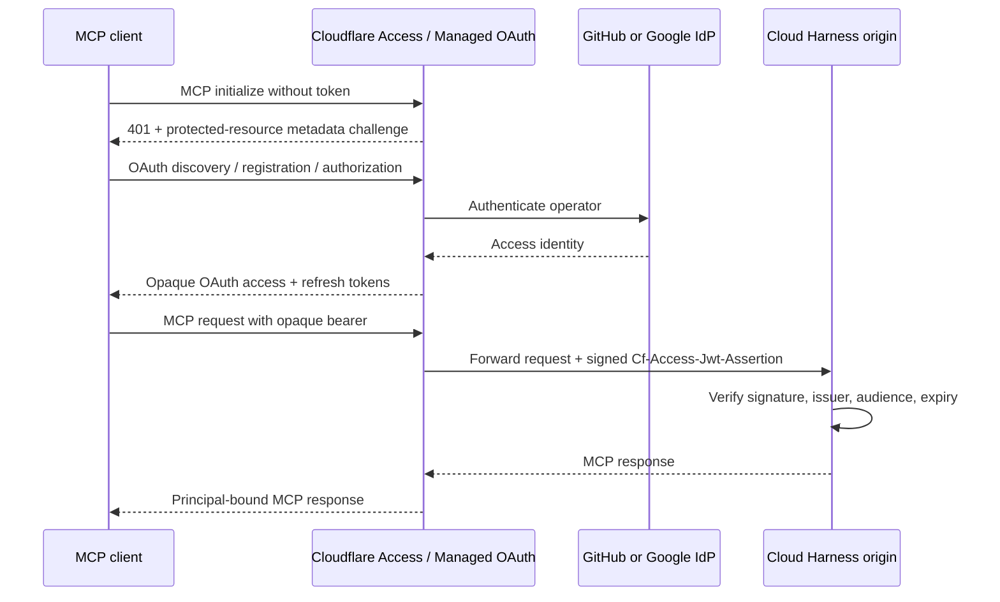

# Security model

## Intended use

Cloud Harness MCP is for one authenticated trusted owner, or a named set of
mutually trusted operators in one security domain, operating owner-approved
repositories. It is not an anonymous service, a general team sandbox, or a
hostile multi-tenant platform. Principal-qualified authorization prevents
accidental cross-operator access; it does not strengthen the shared-kernel
executor boundary.

`exec_run`, interactive shells and sessions, detached tasks, repository hooks,
skill scripts, and repository-defined deployments are intentional remote code
execution inside the executor. Public authentication controls who may request
that execution; it does not make the repository code trustworthy.

## Trust boundaries

Trusted control plane:

- the VPS, Docker daemon, deployment identity, nginx, API, runner, runtime
  configuration, and executor image;
- the rootful runner's Docker socket mount, which is host-root-equivalent
  authority.

Untrusted execution input:

- repository content, dependencies, Git metadata, hook and deployment
  manifests, skills, memories, and commands supplied through tools.

The API is deliberately separated from Docker authority. A credential-free
TCP proxy is the only Compose service with a loopback-published port. It joins
the API frontend network but not the API/runner control network, and the API
joins the internal frontend and control networks plus a dedicated egress
network required to retrieve the configured Cloudflare Access JWKS. JWKS
fetching remains limited by the verifier's fixed URL, redirect rejection,
timeouts, response bounds, and key-cache controls. The runner has no
published port and is the only service with `/var/run/docker.sock`; it uses a
separate egress network for DNS validation, optional GitHub App calls, and
the optional Cloudflare Access API integration while the API/runner control
network remains internal.
The executor does not receive that socket, host credentials, or arbitrary host
mounts. The exact container flags are owned by
[`apps/runner/src/workspace-service.ts`](../apps/runner/src/workspace-service.ts);
Docker-backed checks live in
[`test/integration/docker-sandbox.docker.test.ts`](../test/integration/docker-sandbox.docker.test.ts).

Rootful Docker and a shared kernel remain the principal limitation. A runner
compromise can control the host, and a container escape crosses the executor
boundary. Do not expose this design to mutually distrustful tenants. That
requires a separate execution host or VM/microVM-grade boundary, quota-backed
storage, per-tenant identity/authorization, and stronger abuse controls. For the
architectural roadmap, hardware-isolated microVM criteria, and formal owner
gating governing future multi-tenant platform expansion, see
[`docs/adr/0001-multi-tenant-isolation-and-haas-ladder.md`](adr/0001-multi-tenant-isolation-and-haas-ladder.md).

## Public authentication and request controls

The default `owner-bearer` mode authenticates one long-lived replayable owner
secret and exposes MCP only. The opt-in `cloudflare-access` mode delegates
login, OAuth discovery/token issuance, and coarse admission to Cloudflare
Access. The origin derives identity only from the verified forwarded Access
assertion; the opaque client bearer is not interpreted as identity. The two
modes cannot be enabled ambiguously.

Access policies may offer GitHub and Google login, but Cloud Harness keys
authorization only on Access-normalized `(issuer, subject)`. Email and display
name are metadata, not linking signals. Subject recovery is an explicit,
collision-checked operator mapping with a redacted audit record; there is no
first-login or same-email takeover path. Cloudflare hostname ownership, Zero
Trust policy, IdP setup, revocation, and client compatibility remain external
operator controls that code and unit tests cannot prove.

The API checks hostname policy and an Origin allowlist before dispatch. In
Access mode, `/dashboard` additionally requires the Access assertion and
same-origin CSRF session for mutations. Browser responses use a strict
allowlist and must not contain the MCP/runner token, Access assertion, raw
secret, GitHub App credential, or minted provider token. The API also applies
bounded request size, process-local request/concurrency limits,
no-store/nosniff headers, and a runner deadline.

These controls are implemented in
[`apps/api/src/request-security.ts`](../apps/api/src/request-security.ts),
[`apps/api/src/auth.ts`](../apps/api/src/auth.ts), and
[`apps/api/src/app.ts`](../apps/api/src/app.ts). Process-local limits reset on
API restart and are not a distributed denial-of-service control.

Dashboard-managed API keys add a separate static-client lane without weakening
the Managed OAuth lane. The public `api.harness.zuey.me` Worker is a fixed
streaming proxy with exactly two paths: `/mcp` to `harness.zuey.me/mcp-api-key`
and `/mcp-gateway` to `harness.zuey.me/mcp-api-key/gateway`; every other path is
`404`. For both it rebuilds a small
header allowlist, discards caller-supplied Cloudflare and forwarding identity,
and injects its own Access service-token headers. The hidden origin path is
protected by a separate path-scoped Access application and audience. The
origin requires both a cryptographically verified assertion for the exactly
pinned gateway service subject and a valid principal-bound API key. Neither
credential is sufficient alone, and the reserved gateway subject is rejected
on the normal `/mcp` and `/mcp-gateway` routes. Keeping the gateway origin route
under `/mcp-api-key/` keeps it inside the same path-scoped Access application.
Managed keys carry no scopes, so every active key, including keys issued before
the gateway path existed, also reaches the MCP gateway of its bound principal:
it can search and `execute` that principal's allowed downstream tools with the
credentials the principal stored for them. Treat a key as the principal's full
static-client authority, and revoke or rotate any key that may have leaked. Before forwarding, the Worker enforces the
manifest-owned aggregate Rate Limiting binding and fails closed if the binding
cannot answer. That edge-local, eventually consistent cap is defense in depth;
the origin still enforces authoritative per-credential concurrency and request
limits. The executable owners are
[`apps/api-key-gateway/src/gateway.ts`](../apps/api-key-gateway/src/gateway.ts),
[`apps/api/src/auth.ts`](../apps/api/src/auth.ts), and
[`apps/runner/src/api-key-store.ts`](../apps/runner/src/api-key-store.ts).

An API key inherits its creator's full MCP authority, including arbitrary
remote command execution. It is not a fine-grained capability and has no tool
scopes. The browser can create, list, and revoke keys only through the existing
Access-authenticated, same-origin CSRF boundary. Plaintext is shown once;
SQLite retains only the SHA-256 digest and non-secret metadata. Expiry is
mandatory (configurable up to 3,650 days, approximately 10 years; choosing a longer lifetime lengthens exposure if the secret is compromised). Revocation takes effect on the next request, and authentication has
no positive cache. Treat disclosure as full account compromise: revoke the key,
inspect redacted audit and request metadata, and create a replacement only
after the leak path is closed.

That authority includes model setup. A principal-bound API key, like an OAuth
MCP client or the owner bearer, can create and update its principal's agent
model profiles through the public `model_*` tools, within the guards described
under Model Setup over MCP: a created profile is saved `DISABLED` until the
owner activates it on the Dashboard, an update that escalates spend, permissions,
or the credential is refused, and a Custom key can reach only an upstream URL
already bound to that credential. A key cannot read, create, or rotate a
provider key, activate a profile, or change a spend policy.

In owner-bearer mode, rotate `MCP_BEARER_TOKEN` after suspected disclosure and
restart the API. In Access mode, revoke at Access/IdP and verify the edge no
longer forwards an accepted assertion. Rotate `RUNNER_TOKEN` independently and
restart both control services. Review logs for exposure before resuming
service; tokens must not appear in URLs, commands, documentation, or source
control.

### Inbound MCP OAuth: Cloudflare Access is the authorization server

This is the canonical explanation of the Managed OAuth lane; other pages link
here instead of restating it. In `cloudflare-access` mode, Cloudflare Zero
Trust Access with Managed OAuth enabled is both the OAuth authorization server
that MCP clients see and the public protection layer in front of the origin.
The client-facing bearer and the origin-facing assertion are different
credentials:

1. An unauthenticated MCP request stops at Access, which answers with the
   OAuth protected-resource challenge and discovery path.
2. Discovery, dynamic client registration where enabled, browser
   authorization, token issuance, refresh, and revocation all terminate at
   Access. Cloud Harness does not issue or refresh client tokens.
3. GitHub and Google authenticate the operator as Access identity providers.
   Cloud Harness never treats either provider as its OAuth server.
4. The client presents an opaque bearer to Access. Access validates it at the
   edge and forwards a signed `Cf-Access-Jwt-Assertion`. The origin verifies
   that assertion against the pinned issuer, audience, and JWKS
   ([`access-jwt-verifier.ts`](../apps/api/src/access-jwt-verifier.ts)) and
   derives the principal from it ([`auth.ts`](../apps/api/src/auth.ts)); it
   never uses the opaque bearer as identity or validates it.
5. Access is only the public authentication and admission edge. It does not
   join the Compose control network and gains no API-to-runner, Docker,
   workspace, or repository credential authority.
6. The Managed OAuth endpoint and the static API-key endpoint described above
   are separate, non-interchangeable lanes with independent trust boundaries.

The repository owns the origin side: assertion verification, principal
derivation, and the post-deploy canary in
[`deploy-canary.mjs`](../scripts/deploy-canary.mjs), which calls MCP through
Access with a service token; it proves the edge-to-origin assertion path, not
the interactive Managed OAuth client flow. The Access application,
its policies, IdPs, Managed OAuth settings, redirect allowlist, and revocation
are operator-owned live Cloudflare configuration, set up through the
[Cloudflare Access rollout](deployment.md#cloudflare-access-rollout). Token and
session lifetimes are covered in
[Inbound MCP OAuth session lifetimes](#inbound-mcp-oauth-session-lifetimes).

### Inbound MCP OAuth session lifetimes

Three lifetimes govern a Managed OAuth client and must not be conflated:

- the **access-token lifetime** stays short, because every refresh re-checks
  the Access policy; lengthening it delays revocation without reducing
  sign-ins;
- the **OAuth grant (refresh) session** decides how long a client stays signed
  in without an interactive login; and
- the **browser Access session** for the dashboard is a separate Access
  setting that Cloud Harness does not read or change.

Dashboard Settings can read and update the first two through an optional
runner-only Cloudflare API token. That token is control-plane authority over
the protected Access application, so it follows the GitHub App key boundary:
the API blanks it, and the ingress, executors, logs, and Dashboard responses
never receive it. [`scripts/verify-compose-boundaries.mjs`](../scripts/verify-compose-boundaries.mjs)
enforces the Compose side. Scope the token to one account with
**Access: Apps and Policies Write**, or **Read** for a read-only integration.
Cloudflare offers only a full-application update, so a token that can change
the grant can also change the application's policies and hostname coverage;
treat its disclosure like a compromise of the Access edge and revoke it in
Cloudflare.

Writes fail closed. The adapter re-reads the application, refuses the save when
its OAuth configuration changed since the operator loaded the page, changes
only the two grant fields, keeps policies attached by reference, and reports
success only after a matching read-back. SCIM-enabled and non-self-hosted
applications are refused because their full state cannot be round-tripped. On
startup the runner applies the provider maximum only to a new install whose
grant duration has never been set explicitly; it never overwrites a customised
grant or an explicit access-token lifetime outside the panel bounds, and offers
**Adopt** in Settings instead. Provider writes from one runner are serialized,
so the startup default cannot replace a concurrent Dashboard save. Dashboard
saves are audited as `settings.oauth_grant.changed`; the startup default has no
acting principal, so it is logged by the runner and shown in Settings as applied
automatically at first start. A PUT that times out or fails server-side is
reported as unconfirmed, never as unchanged. The owners are
[`apps/runner/src/cloudflare-access-oauth-provider.ts`](../apps/runner/src/cloudflare-access-oauth-provider.ts)
and
[`apps/runner/src/oauth-grant-settings-service.ts`](../apps/runner/src/oauth-grant-settings-service.ts);
the provider boundary and the deferred owned authorization server are recorded
in [ADR 0002](adr/0002-inbound-oauth-grant-provider.md). The Cloudflare
exchange is unit-tested against a fetch double, not verified against a live
account.

## MCP gateway egress and credential resolution

The `/mcp-gateway` composition root adds the first user-configurable API egress
path in this system. Three facts define its boundary.

1. **The API dials principal-configured MCP URLs.** Endpoints are validated at
   write time and again before every request: https-only (cleartext HTTP only in
   `owner-bearer` mode, and only with both `MCP_GATEWAY_ALLOW_INSECURE_HTTP` and
   `MCP_GATEWAY_ALLOW_PRIVATE_ENDPOINTS`), no URL userinfo, query, or fragment,
   and rejection of loopback, private, link-local, CGNAT, and cloud-metadata
   targets. The socket is **pinned at connect time** to the addresses that
   validation resolved through a dedicated undici `Agent`, so a rebinding
   resolver cannot redirect a credentialed request. Redirects are refused, and
   the body and connection lifetime are bounded. This traffic uses only the
   API's dedicated egress network; the runner never dials a configured URL.
2. **The runner resolves referenced global secrets to the API over the existing
   service-token channel.** Resolution is scoped to one server and an explicit
   `execute` or `connect` purpose, is refused for a disabled server and for a
   denied or unknown tool on the `execute` path, and is audited as
   `mcp_gateway.credentials_resolved`. A resolved value never reaches a
   browser, tool result, trace, or log; error and text redaction covers raw and
   encoded forms. The API attaches the resolved headers only to a request whose
   origin and pathname equal the configured endpoint's — the MCP requests the
   server is configured for. A request to any other origin or path, including a
   redirect target, a discovery probe, or an OAuth metadata fetch, never carries
   them.
3. **Honest residual risk.** The API process heap becomes a place where a
   plaintext global secret exists while a credentialed downstream call is in
   flight, and because the principal chooses both the `secretRef` and the
   endpoint, a principal who references a secret authorizes sending that secret
   to that endpoint. **An API-process compromise is therefore a global-secret
   compromise**, and the URL policy, socket pinning, header scoping, and
   redaction limit that exposure without eliminating it. Treat API-process
   memory as secret-bearing: do not attach debuggers, heap dumps, or core dumps
   to a running API, and rotate the referenced secrets if that boundary is
   crossed.

## MCP Events webhook egress

[MCP Events](mcp-api.md#mcp-events-webhook-delivery) add a second
principal-chosen API egress destination: the webhook callback URL a client
passes to `events/subscribe`. The boundary reuses the gateway's address policy
and adds these decisions:

- **The API dials; the runner never does.** The runner records events in its
  state database and leases due deliveries, with their unsealed signing
  secrets, to the API over the service-token channel. Only the API's egress
  network reaches a callback.
- **Callback URLs are public HTTPS only.** No embedded credentials, no
  fragment, and no loopback, private, link-local, CGNAT, or metadata target.
  The URL is validated at subscribe time and re-resolved and re-validated
  before every attempt, with the socket pinned to the validated addresses, so
  a hostname that later rebinds inward is never dialled. Redirects are not
  followed (a `3xx` counts as a failed attempt), and resolution, request time,
  and response size share one bound.
- **Proof of control before delivery.** A signed verification challenge must
  be echoed before a principal's first subscription to a callback URL, so a
  client cannot direct signed traffic at an endpoint it does not control.
- **Minimal payloads.** Events carry identifiers, statuses, codes, and
  timestamps, never command text, output, prompts, or messages. Recorded
  failure reasons are server-generated categories, never the receiver's
  response body; the dashboard shows only the callback origin, because a path
  can carry receiver routing tokens.
- **Sealed secrets.** Webhook secrets are encrypted with the runner keyring,
  bound to the subscription and secret generation, never returned by any
  listing, and re-sealed by the `secrets:rekey` entry point.
- **Revocation tracks the credential.** A subscription created over a managed
  API key is revoked when the next delivery is claimed after that key is
  revoked or expires. Dashboard revocation is not a block list: the client can
  re-subscribe while its credential stays valid. Subscribe, rotation,
  unsubscribe, and revoke actions are recorded in the audit log as
  `mcp_event.*` entries.

Residual risk: a principal can make the API send small signed requests to any
public HTTPS endpoint that answers the challenge. That is accepted for this
single-owner harness and is bounded by the per-principal subscription quota.
The executable owners are
[`apps/api/src/events/webhook-sender.ts`](../apps/api/src/events/webhook-sender.ts),
[`apps/api/src/mcp-gateway/url-policy.ts`](../apps/api/src/mcp-gateway/url-policy.ts),
and [`apps/runner/src/mcp-event-service.ts`](../apps/runner/src/mcp-event-service.ts).

## Downstream MCP OAuth client

The gateway can also hold an OAuth grant for a downstream MCP server. This is
an **outbound** credential that Cloud Harness obtains and presents to a
third-party server; it is not the inbound Cloudflare Access Managed OAuth lane
that admits clients to Cloud Harness, and neither lane's tokens or
configuration reach the other. The [MCP gateway](mcp-gateway.md#downstream-oauth)
records the product decisions; the controls below are the boundary.

- **Authorization is user-initiated and bound.** Only an explicit dashboard
  Connect creates a flow. The flow uses PKCE with `S256` and a high-entropy
  `state` that is stored only as a hash, is single-use and short-lived, and is
  bound to the starting principal and server; a foreign principal's callback
  finds no flow. The callback derives its redirect target from the stored
  flow, never from a query parameter, checks the authorization response `iss`
  against the expected issuer, and the token request is bound to the
  configured MCP resource (RFC 8707). Background Test, Refresh, and `execute`
  can use or refresh an existing grant but cannot register a client, exchange
  a code, or open a browser; they return `AUTHORIZATION_REQUIRED` instead.
- **Grants stay in the runner, encrypted.** Grants and pending flows are
  sealed with the runner keyring under associated data naming the principal,
  the record kind, and the record (server and generation for a grant, flow for
  a pending flow), so a ciphertext copied to another principal or record fails
  to decrypt. The API loads a grant over the internal
  service-token channel only for the call that needs it. Rotated tokens are
  saved with a generation compare-and-swap so a stale refresh cannot overwrite
  a newer token. Owners:
  [`apps/runner/src/mcp-oauth-store.ts`](../apps/runner/src/mcp-oauth-store.ts)
  and [`apps/api/src/mcp-gateway/oauth-provider.ts`](../apps/api/src/mcp-gateway/oauth-provider.ts).
  The `secrets:rekey` entry point re-encrypts these tables too; see
  [secret key rotation](operations.md#secret-key-rotation).
- **No token in any view.** Server views, the OAuth status projection,
  dashboard responses, traces, logs, and audit details carry no access token,
  refresh token, code, verifier, or client secret. Stored errors are scrubbed
  of credential-shaped values before persistence.
- **OAuth traffic is SSRF-hardened separately from MCP traffic.** Discovery,
  registration, token, and revocation requests go through
  [`apps/api/src/mcp-gateway/oauth-fetch.ts`](../apps/api/src/mcp-gateway/oauth-fetch.ts):
  each URL is validated against the same gateway URL policy and the socket is
  pinned to the validated addresses, redirects are refused, and the response
  is read under the gateway byte and time caps. Static MCP headers never reach
  these requests, and the bearer token is attached only to requests for the
  configured MCP endpoint.
- **Audited.** Start, completion, refresh, failure, reauthorization,
  revocation, and disconnect write `mcp_oauth.*` audit events carrying the
  issuer, scopes, or outcome, never secret material.

Residual risk follows the gateway pattern above: the API heap holds a
plaintext token while a downstream call is in flight, and a principal who
connects a server authorizes Cloud Harness to act at that server with the
granted scopes. Disconnect revokes best effort only; a server without a
revocation endpoint keeps honouring an issued token until it expires.

## Executor and repository controls

Executors run as a non-root UID with a read-only root filesystem, dropped
capabilities, `no-new-privileges`, bounded CPU/memory/PIDs/file descriptors,
bounded per-operation and aggregate retained output, bounded operation-handle
counts, and TTL cleanup. Only the workspace repository mount is writable.

The shipped default executor network profile is `dependency-access`, so a
workspace can reach the GitHub API and the bundled `gh` CLI without an explicit
request. `network-none` is the per-workspace or instance-wide opt-out that
blocks all executor egress, including dependency installation and networked
repository commands. The dashboard Settings page owns that instance-wide default
through dashboard-only internal runner operations; it is instance state rather
than principal state, so in a deployment that serves more than one principal any
authenticated dashboard principal can change the posture of future workspaces.
The same boundary covers the **Workspace limits & lifecycle** settings (the
per-principal active-workspace quota, idle and wall TTLs, and recoverable
grace): any authenticated dashboard principal with a valid CSRF token can
change them for the whole instance, each change is audited as
`settings.workspace_lifecycle.changed`, and no MCP tool reads or writes them.
Raising the quota multiplies the per-executor resource ceilings a principal can
hold; a zero grace is accepted only with an explicit acknowledgement, and
auto-close still retains unsaved work. That matches the single-owner threat
model this harness is built for; a multi-tenant deployment needs an admin gate
on the settings mutation before it can rely on per-principal policy. The `dependency-access` profile is enforced below MCP
tool policy: the executor attaches only to a dedicated managed Docker bridge
(`chm-egress0`) with inter-container communication disabled and Docker's
default masquerade off, and a transactional host firewall (installed via a
single `iptables-restore` commit and verified through an ephemeral
`NET_ADMIN`-only network-guard container) permits only public DNS and public
TCP 80/443. The managed jump is the first rule of both `INPUT` and
`DOCKER-USER`, and forbidden destination classes — loopback-to-host,
Docker/control-plane, RFC 1918, carrier-grade NAT, link-local, and
cloud-metadata (`169.254.169.254`) — are rejected before the allowed ports.
IPv6 is disabled on the bridge. The runner attests the Docker network and the
exact ordered host ruleset before every dependency executor start and during
periodic reaper reconciliation; on drift it fences the workspace to
`NETWORK_QUARANTINED`, stops the executor, and retains its data for recovery
after policy reconciliation. If attestation is unavailable the profile fails
closed (`DEPENDENCY_EGRESS_UNAVAILABLE`) and never falls back to broad bridge
egress. `dependency-access` is not an allowlisted proxy or DLP boundary: it
still permits exfiltration and callbacks to public endpoints. Production
enforcement targets Linux with the Docker iptables backend; the host firewall
is a trusted operator-owned control outside the executor's authority.

Repository opening accepts only credential-free HTTPS URLs on configured
hosts and rejects private/link-local resolutions. The clone helper disables
hooks, recursive submodules, tag downloads, redirects, and LFS smudging.
Repository code is never evaluated by the runner during clone.

Optional GitHub App credentials remain in the runner. Access GitHub SSO never
grants repository access. A separate principal-bound App installation and
verified repository grant authorize private Git operations. Short-lived,
repository-scoped tokens are supplied over stdin only to ephemeral clone,
fetch, or push helpers; the stored remote stays credential-free and the helper
environment never receives a token. Remote fetch/pull first stage outside the
executor and import without network or credentials. Push first stages a bare
snapshot without credentials, then uses a separate networked helper. Transfer
directories and helper containers are removed after the operation.

#### Operator-supplied GitHub credential fallback

A GitHub App is optional. When no App repository token can be minted, Git and
`github_action` operations fall back to an operator-supplied GitHub credential,
resolved in this order:

1. `GH_TOKEN`, then `GITHUB_TOKEN`, from the runner process environment (each
also accepting a `_FILE` form); then
2. an active global runtime secret named `GH_TOKEN`, then `GITHUB_TOKEN`, held by
the requesting principal.

The environment source is honored **only** in `owner-bearer` mode. In
`cloudflare-access` (multi-principal) mode it is refused entirely, because a
single operator-wide credential must never stand in for a different
principal's App grant; those deployments use the per-principal secret instead.
Values that cannot be GitHub credentials (shorter than 20 characters or
containing whitespace) are ignored, so an unrelated environment variable or
secret cannot be sent to GitHub as a token. Resolved credentials are registered
with the ingest-time redactor. The owning resolution logic and its tests are
[`apps/runner/src/github-credential-fallback.ts`](../apps/runner/src/github-credential-fallback.ts)
and
[`apps/runner/test/github-credential-fallback.test.ts`](../apps/runner/test/github-credential-fallback.test.ts).

This fallback is deliberately weaker than an App token: a personal access token
is not scoped to one repository and cannot be bounded by an installation grant,
so prefer the narrowest fine-grained token, or a GitHub App where one is
practical.

### Owner-scoped repository cache isolation

When repository caching is enabled (`enableRepoCache: true`):

1. Bare repository caches are stored under `repoCacheRoot` partitioned strictly by the authenticated principal's opaque ID (`<repoCacheRoot>/<principalId>/...`). Cross-principal cache access is structurally impossible.
2. Cache initialization uses ephemeral helper containers that mount the owner's cache directory writable (`:rw`) to clone the bare repository mirror. Once READY, existing mirrors are referenced without ongoing background synchronization.
3. Initial workspace checkouts mount the cache directory strictly read-only (`:ro`) in the clone helper and use `git clone --reference-if-able <cache> --dissociate <workspace>`. The `--dissociate` flag copies referenced objects into the workspace repository during creation, severing any ongoing link to the shared object store before the executor starts.
4. Checkouts are fully independent and writable only to their own workspace; no writable Git state is ever shared across workspaces or principals.

### Brokered GitHub actions

Authenticated GitHub operations (`pr_list`, `pr_view`, `pr_create`, `pr_update`, `pr_comment`, `pr_review_threads`, the review, reviewer, draft/ready, and merge actions listed in `docs/mcp-api.md`, `issue_list`, `issue_view`, `issue_create`, `issue_comment`, `issue_comment_update`, `label_create`, `issue_labels_add`, `issue_labels_remove`, `issue_update`, `issue_publish`) are executed through the `github_action` tool using an ephemeral helper container (`worker/gh-helper.sh`). Action-scoped tokens (`pull_requests: read|write`, `issues: read|write`, each also carrying `contents: read`) are minted by the runner from the trusted GitHub App installation, or resolved from the operator fallback described above when no App token is available, and passed exclusively via `stdin`. `pr_merge` and `pr_auto_merge_enable` additionally mint `contents: write`, and are refused with `GITHUB_PERMISSION_MISSING` naming both scopes when the token GitHub reports lacks it; they never widen any other action. Issue actions that take a number (`issue_view`, `issue_comment`, `issue_update`, `issue_labels_add`, `issue_labels_remove`, `issue_publish`) also ask for `pull_requests` at the same level, because every pull request is also an issue and `gh` resolves the number through `issueOrPullRequest`, which GitHub refuses for a pull request without that permission. That scope is optional: when the installation does not grant it, the runner mints the issues-only token instead, and GitHub's refusal on a pull request number (`Resource not accessible by integration`) is reported as `GITHUB_PERMISSION_MISSING` naming `pull_requests` and the matching `pr_*` action. The accompanying `contents: read` is required for the action to work at all: `gh` resolves repository metadata (such as `defaultBranchRef`) over the GraphQL API, and GitHub refuses those fields for a token narrowed to the action scope alone. The helper container runs read-only with dropped capabilities, and is forcibly removed on all exit paths in a `try/finally` block. Credentials resolved this way never enter the helper environment, workspace filesystem, workspace environment, client result, or audit payload.

The merge-train actions follow the same model with their own GitHub permission: `commit_status_get`/`commit_status_create` mint `statuses: read|write`, `check_runs_list` mints `checks: read`, and `workflow_runs_list`, `workflow_run_view`, `workflow_dispatch`, and `workflow_run_rerun_failed` mint `actions: read|write`, each beside `contents: read`. A dispatch runs workflow code the repository already holds on the named ref; it passes only string inputs and never a harness credential. The helper validates SHAs, refs, workflow identifiers, and run IDs before placing them in a REST path.

The read-only `commit_list`, `compare`, `release_list`, `tag_list`, and `ref_get` actions mint a `contents: read`-scoped token directly (no `pull_requests`/`issues` scope needed) and are reachable through either `github_action` or the non-destructive `github_read` tool, which shares this broker and helper so read-only calls do not carry `github_action`'s tool-level destructive annotation.

All write mutations and token authorization denials emit auditable events (`github_action.<action>`) into `audit_events` recording principal, repository, target entity numbers, success status, and structured error codes without storing token secrets or unbounded request payloads. Helper execution failures are classified into structured, typed error codes (`GITHUB_RATE_LIMITED` with retryAfterMs, `GITHUB_PERMISSION_MISSING`, `INVALID_PULL_REQUEST_BASE`, `GITHUB_ACTION_FAILED`, and the review/merge codes documented in `docs/mcp-api.md`) to provide deterministic machine-readable recovery semantics for autonomous agents.

### Three-zone storage and toolchain isolation

Executors operate across three partitioned storage zones:

1. **Zone A (Secrets & Session Config)**: `/tmp/cloud-harness-home` backed by RAM tmpfs (`128MB`), containing ephemeral configurations, temporary tokens, and tool cache metadata. Destroyed on container exit and cannot be committed into Git.
2. **Zone B (User-Space Toolchains & Caches)**: `/opt/user-tools` and `/var/cache/harness` mounted from runner-managed job paths with UID `10001:10001` ownership and mode `0755`. Accommodates global user-space toolchain installations (`npm -g`, `bun`, `uv`, `pnpm`, `wrangler`) without requiring root.
3. **Zone C (Git Repository)**: `/workspace` containing the clean repository working tree.

Workspace disk usage metering calculates the combined footprint of all three persistent zones against `maxWorkspaceBytes`.

### Skill tiers and execution isolation

Skills are resolved across four deterministic precedence tiers (`built-in > owner > workspace > repository`):

1. **Built-in & Owner Tiers (`/opt/cloud-harness/skills:ro`, `/opt/cloud-harness/owner-skills:ro`)**: Mounted read-only (`:ro`) at the container boundary. Because they reside on immutable host mounts, processes within the executor (including any process running as UID 10001) cannot modify these skill files.
2. **Workspace & Repository Tiers (`/workspace/.cloud-harness/skills`, `/workspace/.agents/skills`)**: Reside on the mutable working tree volume. Execution creates an isolated snapshot under `/tmp/cloud-harness-exec/<runId>` and validates the full-tree bundle digest and script SHA before invocation to prevent unintentional concurrent filesystem race conditions. Within the single-tenant container boundary, all processes share UID 10001; users requiring kernel-enforced mount immutability should install skills into the `owner` scope. A skill revision that carries instructions but no scripts is refused with `NO_EXECUTABLE_ASSETS` rather than a generic miss, because the revision exists and simply has nothing to run. Where those bytes execute is a deliberate choice, not an accident: the script runs in a disposable helper container launched through `runPrivilegedEphemeralExec`, which is gated on an owner privilege grant. Without a grant the runner returns `PRIVILEGE_APPROVAL_REQUIRED` naming the grant it needs, and it never falls back to running the script locally, so a caller cannot read a stronger isolation guarantee into the result than the run actually had. The response reports `executionMode: 'helper-container'`. The helper container reuses the worker's one-shot entry point, so the isolated snapshot, the full-tree bundle digest, and the script SHA checks described here still happen before the script is invoked; only the process that finally runs it moves into a container of its own.

### Skills served over MCP

The [Skills over MCP extension](mcp-api.md#skills-over-mcp-extension) is a
read-only distribution channel, not an execution or approval path:

- **Owner scoping.** The API forwards only the authenticated principal, and the
  runner reads owner skills through a store query scoped to that principal, so
  another principal's library is never a candidate. Unauthenticated requests
  are refused before reaching the runner. Built-in skills are served to every
  authenticated principal, as they are mounted into every executor.
- **Workspace binding.** Workspace and repository skills are served only on
  the workspace-bound endpoint, and only from the one workspace it names. The
  runner re-authorizes that workspace on every call by an owner-scoped lookup
  of its explicit id, never the caller's implicit "active" workspace, and
  requires it to be `ACTIVE` with an unexpired lease. Missing, foreign, and
  ended workspaces get one identical error, so the endpoint does not reveal
  whether another principal's workspace exists, and access stops on the next
  call after a close or expiry; a call already in progress is not interrupted.
  A URI naming another workspace is refused.
- **Repository-controlled bytes.** Workspace and repository skills are read
  from a checkout the executor can rewrite at any moment, so they are treated
  as hostile input: a skill root or skill reached through a symlink is
  ignored, and every directory and file is opened without following a final
  link and then checked, through the kernel's record of the open descriptor
  (`/proc/self/fd`), to be exactly its canonical path inside the checkout, so
  a parent directory swapped for a link during the walk cannot redirect a
  read; directory entries are read through the verified descriptor. Where that
  check is unavailable these tiers serve nothing. A skill is keyed by its
  directory name, which must match its frontmatter `name`, only the first 60
  directories of each root are considered, only a bounded head of each
  `SKILL.md` is parsed, and the same file-count, size, depth, and URI bounds
  apply. These manifests are never cached, and a read whose bytes differ from
  a manifest built in the same call is refused as stale instead of answered.
- **Untrusted content.** Served frontmatter and files are passed through
  verbatim. Owner and imported skills are owner- or third-party-authored text,
  and repository skills are whatever the checked-out repository contains, so
  hosts and agents must treat them as untrusted input. Digests prove
  consistency with the manifest, not trust in the content.
- **Verified reads.** Manifests are hashed from the bytes on disk on every
  call, files are opened without following symlinks, and a read whose bytes no
  longer match the manifest fails instead of returning them. A skill containing
  a symlink or special file is not served at all, so a published manifest
  always describes the whole directory. Filesystem errors are reported without
  host paths.
- **No activation.** Reading a skill never loads it into a workspace or runs a
  script. `skills_run` keeps its own bundle-digest pin and privilege grant.

Dashboard ZIP import publishes each skill's whole directory, so scripts and
assets become owner-tier content and the revision records whether it carries
executable assets. The importer refuses archives with symlink or special-file
entries, ignores platform metadata and files outside a skill directory, and
rejects a single skill over the served per-skill bounds with a per-item
`LIMIT_EXCEEDED` result instead of publishing it partially. The executable
owner is [`apps/runner/src/skill-archive.ts`](../apps/runner/src/skill-archive.ts).

### Privileged execution and operator approval grants

Standard executors strictly preserve `--read-only`, `--cap-drop ALL`, `--security-opt no-new-privileges`, and user `10001:10001`. Sudo/root execution is treated as an explicit owner-approved threat model weakening (similar to `networkMode: bridge`).

When `exec_run` is invoked with `privileged: true`:

1. Privileged execution is supported in `cloudflare-access` mode (where the operator dashboard is authenticated via Cloudflare Access) and is disabled in `owner-bearer` mode to prevent self-approval.
2. In `cloudflare-access` mode, an unapproved request is rejected with `PRIVILEGE_APPROVAL_REQUIRED` and returns a single-use `grantId` bound to the command and working directory with a 60-second TTL.
3. The operator must explicitly approve the grant via the authenticated Dashboard BFF API (`POST /api/v1/privilege-grants/:grantId/approve`). MCP clients cannot self-approve.
4. The caller provides the `approvalGrantToken`. The runner validates the grant and command/cwd hash, atomically consumes it (single-use), and executes the command in an isolated ephemeral container with `try/finally` cleanup. The standard executor container remains permanently hardened and unmodified.

The Dashboard Approvals page lists grants in every state the runner returns,
labelled with their real status, and offers Approve and Reject only for an
unexpired pending grant; only those count toward the rail badge. A decided,
consumed, or expired grant is shown without actions, so the page never invites
a decision the runner would refuse. The owner is `grantIsActionable` in
[`apps/api/dashboard/dashboard-render.js`](../apps/api/dashboard/dashboard-render.js).

The `bash` tool has no privileged path: its `workspace` target delegates to
unprivileged `exec_run`, and privileged commands stay on `exec_run` with the
grant flow above. Its `toolbox` target, off unless the operator sets
`PACKAGES_ENABLED=true`, runs each command in a fresh executor-image container
with the same hardening flags, `--network none`, no mounts, no secrets, and no
Docker socket. The container is created before it is started, so it exists by
name before any stop decision; on exit, timeout, output bound, or abort the
runner removes it by that exact name and retries for about 10 seconds until
Docker reports it gone. Two backstops cover a runner that dies or a removal
that keeps failing: an in-container `timeout` deadline slightly beyond the
caller's timeout, and the periodic reaper, which removes this instance's
toolbox-labelled containers older than the longest command timeout plus a
margin. `TOOLBOX_MAX_CONCURRENT` caps how many toolbox containers run at once,
so toolbox calls cannot take more than that many executor-sized memory, CPU,
and pid budgets from the host. The
executable owner is
[`apps/runner/src/toolbox-runner.ts`](../apps/runner/src/toolbox-runner.ts),
with evidence in
[`test/integration/bash-toolbox.docker.test.ts`](../test/integration/bash-toolbox.docker.test.ts).

The public contract fixes remote transfers to `origin`, permits only branch
push refspecs, rejects raw deletion refspecs, and permits force and deletion only
through a lease: an expected object ID (compare-and-swap or delete-if-match) or
an expected-absent create. Policy refusals from the remote (`[remote rejected]`)
are reported as non-retryable `FORBIDDEN`, never as a transport failure. Private clone/fetch/pull require GitHub App Contents read
access, or the operator fallback above; push requires Contents read and write
access, or the operator fallback above. The executable boundary
and its evidence are
[`apps/runner/src/workspace-service.ts`](../apps/runner/src/workspace-service.ts),
[`worker/git-transfer-helper.sh`](../worker/git-transfer-helper.sh),
[`apps/runner/test/git-transfer-leak.test.ts`](../apps/runner/test/git-transfer-leak.test.ts),
and
[`test/integration/git-transfer-helper.docker.test.ts`](../test/integration/git-transfer-helper.docker.test.ts).
Live private-repository verification remains owner-supplied evidence.

### Secrets management and ingest-time stream redaction

Cloud Harness provides credential management partitioned by scope, lifecycle, and encryption boundaries:

1. **Secret Scopes and Precedence:**
   - **Global Secrets:** Active global runtime secrets are bound to the authenticated principal identity and automatically inherited by every remote Docker workspace created by that principal.
   - **Environment Secrets:** Scoped to a specific project environment. Injected only when the client explicitly provides both `environmentId` and `confirmEnvironmentInjection: true` in `workspace_open`.
   - **Precedence Rule:** When a key collision occurs, environment secrets override global secrets with the same name.
   - **Local Stdio Limitation:** Retained secret discovery and injection are unsupported in local stdio workspaces.

2. **Purpose Classification:**
   - Secrets have a `purpose` attribute (`runtime` vs `provisioning`). Only `runtime` secrets are injected into executor container environments; `provisioning` secrets are excluded from runtime container injection.

3. **Encryption at Rest & Write-Only Boundary:**
   - Secret values are write-only through the authenticated, CSRF-protected Dashboard BFF API.
   - Submitted values are encrypted at rest using AES-256-GCM via the versioned runner keyring (`SECRET_KEYRING_FILE`). Ciphertext is stored in SQLite (`secret_versions`, `global_secret_versions`, `workspace_secret_snapshots`, `workspace_secret_snapshot_headers`).
   - Neither the browser dashboard nor MCP tools (`secrets_list`) ever return secret values or ciphertext.
   - During executor creation, runtime secrets are briefly written to an ephemeral mode-0600 host environment file for Docker creation and immediately removed.

4. **GitHub Credential Injection (Explicit Owner-Approved Weakening):**
   - `GH_TOKEN` and `GITHUB_TOKEN` are accepted secret names, unlike every other control-plane, GitHub App, and toolchain name, so an operator can authenticate the executor's bundled `gh` CLI without an interactive login.
   - Because they are ordinary runtime secrets, they are also inherited by every remote workspace of that principal (global scope) or by the selected project environment, and any process in the executor can read them. This is the only harness-supported path that places a repository credential inside an executor environment, and it is an operator opt-in rather than a default: no secret exists unless the operator creates one.
   - Egress is the shipped default, so a credential readable by repository-controlled code is exfiltratable by that code. Mitigate by using a fine-grained token limited to the repositories the workspace needs, or by switching the instance default or the individual workspace back to `network-none`.
   - `GITHUB_APP_*`, `RUNNER_*`, `ACCESS_*`, `CF_*`, `CLOUDFLARE_*`, `HARNESS_*`, `CH_*`, `DOCKER_*`, `XDG_*`, `NPM_*`, `UV_*`, `BUN_*`, `PNPM_*`, `GIT_*`, and `LD_*` names remain reserved and are rejected at both the dashboard and runner boundaries.

5. **Ingest-Time Stream Redaction (Defense-in-Depth):**
   - Secret values meeting the minimum length threshold (≥ 4 UTF-8 bytes) are compiled into the runner's streaming redactor.
   - Streaming task, shell, and session stdout/stderr chunks are sanitized—including matches spanning stream chunk boundaries—before retained memory buffering, preserving monotonic byte cursor offsets. Synchronous `exec_run` command outputs and worker error messages are sanitized after capture before return.
   - Redaction is defense-in-depth: it targets exact raw byte matches and does not match transformed, encoded (e.g., base64 or hex), hashed, or partial secret derivatives. Repository code and commands must not deliberately echo secret material.

Repository-manifest deployments are named commands, not a secret broker. They
execute with the same unprivileged executor environment and network mode as
other repository commands; the harness does not inject host or deployment
credentials. Their manifest parsing and execution owner is
[`worker/harness-worker.mjs`](../worker/harness-worker.mjs).

### Dashboard Terminal

The Dashboard Terminal gives the operator an interactive PTY without adding a
new place where commands run. The decision and its rejected alternatives are
recorded in
[ADR 0003](adr/0003-terminal-bash-and-managed-toolbox.md); this section records
the boundary it keeps.

- **Same executor, no new authority.** The runner opens the PTY through the
  Docker Engine API exec call on the socket it already holds, inside the
  workspace's existing hardened executor, as uid 10001. Nothing runs in the
  API, the runner, or on the host, and the executor gains no capability, mount,
  or credential. Because the exec needs the Engine API directly, terminals
  require a unix `DOCKER_HOST`; any other value makes them unavailable rather
  than falling back to another transport. Owner:
  [`apps/runner/src/docker-pty.ts`](../apps/runner/src/docker-pty.ts).
- **Dashboard-only, re-authorized per call.** Terminal operations are internal
  runner operations, not MCP tools; agents keep `shell_*` and `sessions_*`. The
  browser reaches them only through the dashboard BFF, under the same session
  principal, Origin, and CSRF checks as every other dashboard mutation, and
  request bodies cannot name a workspace, terminal, or principal. The runner
  re-checks that the workspace is owned and active on every call. Owners:
  [`packages/contracts/src/terminal-schemas.ts`](../packages/contracts/src/terminal-schemas.ts),
  [`apps/api/src/dashboard-terminal-router.ts`](../apps/api/src/dashboard-terminal-router.ts),
  and the `terminal_*` dispatch in `executeInternal` of
  [`apps/runner/src/workspace-service.ts`](../apps/runner/src/workspace-service.ts).
- **Bounded in memory.** A per-workspace terminal limit, an idle timeout, a
  maximum lifetime, an input size cap with backpressure, and a retained output
  window addressed by absolute cursors bound what one browser can hold open.
  A reader that fell behind is told how many bytes it missed instead of
  receiving a silently incomplete screen. Long-poll reads are capped and end
  when the browser disconnects, so an abandoned tab does not park a runner
  wait. Limits are configured as described in
  [configuration](configuration.md#dashboard-terminal) and enforced in
  [`apps/runner/src/operation-manager.ts`](../apps/runner/src/operation-manager.ts).
- **Redaction and audit.** PTY output passes through the workspace's streaming
  secret redactor before it is retained, so an injected secret value is neither
  kept nor sent to the browser; the redaction limits in the previous section
  still apply. The audit log records only `terminal.opened` and
  `terminal.closed` with lifecycle metadata (status, end reason, exit code);
  keystrokes and output are never audited, and the PTY transport never logs
  payloads.
- **No resumption.** PTYs live in runner memory. A runner restart forgets
  them, the dashboard reports them as lost, and nothing is resumed. Close ends
  the whole PTY session, including job-control children.
- **Browser posture.** The emulator is the vendored `@xterm/xterm` and
  `@xterm/addon-fit`, served same-origin from an explicit allow-list in
  [`apps/api/src/dashboard-assets.ts`](../apps/api/src/dashboard-assets.ts)
  from the pinned dependency, never from a CDN. The legacy dashboard CSP is
  unchanged.
  xterm writes styles from script, which `style-src 'self'` blocks, so
  [`apps/api/dashboard/dashboard-terminal.js`](../apps/api/dashboard/dashboard-terminal.js)
  installs a CSSOM adapter that turns script-created `<style>` elements and
  `style` attributes into constructed stylesheets and `style.cssText`.
  Markup-delivered styles stay blocked and no nonce or `'unsafe-inline'` is
  introduced. The asset confinement is asserted by
  [`apps/api/test/dashboard-ui-contract.test.ts`](../apps/api/test/dashboard-ui-contract.test.ts).

### Dashboard 2.0 React shell

The React Dashboard ([ADR 0005](adr/0005-dashboard-react-rewrite.md)) is served
by the API under `/dashboard`, behind the same Host, Origin, Access, and CSRF
boundary as the legacy shell; it adds no route outside `/dashboard` and no host
mount. Its CSP differs from the legacy one in exactly two directives:

- **Per-response style nonce.** Every shell response carries a fresh random
  nonce in `style-src 'self' 'nonce-…'`, because Radix and the router inject
  runtime `<style>` elements that `style-src 'self'` alone would block. The
  nonce applies only to styles: `script-src` stays `'self'` with no nonce, no
  hash, and no `'unsafe-inline'`, and the shell is `no-store` so a nonce is
  never replayed from a cache.
- **`font-src 'self'`.** Geist is self-hosted from hashed same-origin assets;
  no external font or CDN host is allowed.

Both are built by `reactShellContentSecurityPolicy` in
[`apps/api/src/dashboard-security.ts`](../apps/api/src/dashboard-security.ts)
and applied in
[`apps/api/src/dashboard-react-assets.ts`](../apps/api/src/dashboard-react-assets.ts),
which serves only files named by the startup-validated Vite manifest, renders
the HTTP-only theme cookie from a fixed set of values, and answers unknown
Dashboard navigations with a 404 shell. The `?ui=react|legacy` canary sets the
`ch-dashboard-ui` cookie (`Path=/dashboard; HttpOnly; Secure; SameSite=Lax`, so the
pin survives the cross-site Access sign-in redirect and links from other sites)
and redirects to the same Dashboard path, never off it. A cross-site GET can
set that cookie, but it only selects which first-party UI an operator sees after
Access; it grants no authority and carries no data, so the impact is low and
`?ui=legacy` reverses it. The assertions live in
[`apps/api/test/dashboard-react-shell.test.ts`](../apps/api/test/dashboard-react-shell.test.ts).

Secret handling in the React pages follows the same write-only rule as the
legacy shell, with these client-side guarantees:

- **Write-only fields live only in the open form.** Secret values and provider
  keys are typed into masked inputs and held only in that dialog's in-memory
  form state (the model profile wizard keeps its key in an uncontrolled input
  outside wizard state). Secret value and key fields are emptied when the
  request is sent, and every field resets when the dialog closes; values never
  reach drafts, the query cache, browser storage or logs, and a failed save
  asks for the value again. MCP server headers differ by mode: a literal header
  value is not a secret, so the BFF returns it and the edit dialog prefills it
  (masked); a secret-reference header names a global secret, whose value is
  write-only and never sent to the page.
- **The one-time API key reveal is component state only.** The `POST /api-keys`
  response is not cached, and the plaintext is dropped on dismiss, on any
  navigation (router or link click), on `pagehide`, when the session ends, and
  on unmount; a reveal is refused once the session has ended
  ([`apps/dashboard/src/lib/one-time-reveal.ts`](../apps/dashboard/src/lib/one-time-reveal.ts)).
- **Wizard restore is allowlisted and session-scoped.** A multi-step wizard may
  keep its step and non-secret choices in `sessionStorage` (prefix
  `ch-dashboard-restore:`) so a reload does not lose progress. Each wizard
  rebuilds that entry from an allowlist on both write and read, so an injected
  key is neither restored nor written back, and the entry is removed on cancel
  and save ([`apps/dashboard/src/lib/restorable-state.ts`](../apps/dashboard/src/lib/restorable-state.ts),
  `parseStoredWizard` in
  [`apps/dashboard/src/features/models/models-wizard-state.ts`](../apps/dashboard/src/features/models/models-wizard-state.ts)).
  The secret fields themselves are never part of a draft (ADR 0005), and a
  custom upstream URL is dropped from it when it does not parse or carries user
  info, a query or a fragment, where a pasted credential would sit. Dialogs
  that take secret values have no draft at all.
  The open-workspace wizard applies the same URL filter to the repository URL
  and also keeps its pending launch's `idempotencyKey`, a non-secret dedupe
  token, beside a SHA-256 digest of the request (never the request itself), so a
  reload after a lost answer replays the same intent instead of opening a second
  workspace. The wizard refuses a repository URL with user info, a query or a
  fragment before anything is sent
  ([`open-workspace-model.ts`](../apps/dashboard/src/features/workspaces/open-workspace-model.ts)).
  The cockpit deploy wizard keeps only the chosen target name; deployment,
  skill and hook output stays in component state.
- **Writes use the unchanged BFF boundary.** Every mutation sends the session
  cookie and the in-memory CSRF token; a `session_ended` 401 bootstraps a new
  session and retries once, anything else surfaces the sign-in path. The
  embedded assistant's writes take the same path
  ([`widget-host-setup.ts`](../apps/dashboard/src/features/assistant/widget-host-setup.ts)),
  so it recovers after an API restart without a reload. Fences
  (`expectedGeneration`, plan digests) are sent exactly as the legacy shell
  sends them, and a 409 reloads the latest version instead of retrying.

[`apps/dashboard/e2e/bff-write-security.spec.ts`](../apps/dashboard/e2e/bff-write-security.spec.ts)
proves the CSRF, Origin and expired-session paths against the real in-process
BFF, and
[`one-time-reveal.spec.ts`](../apps/dashboard/e2e/one-time-reveal.spec.ts) and
[`write-paths.spec.ts`](../apps/dashboard/e2e/write-paths.spec.ts) check that
no secret reaches the DOM, form values, Web Storage, IndexedDB, Cache Storage,
cookies, the console or any read response. That the TanStack Query cache never
holds a one-time reveal is asserted at unit level
([`one-time-reveal.test.tsx`](../apps/dashboard/src/lib/one-time-reveal.test.tsx)),
because the in-memory cache is not reachable from the page.

### Dashboard path ids are authoritative

A Dashboard BFF mutation acts on the resource its URL names. When a JSON body
repeats a path id (`workspaceId`, `environmentId`, `name`, `skillId`, and so
on) with a different value, the request is refused with
`400 path_id_mismatch` before the runner is called. A body that repeats the
same value is accepted, and the path value is always the one forwarded. This
keeps page actions built by the Dewee agent, and any other client, from aiming
a route at a different resource than the one it called. The owner is
[`apps/api/src/dashboard-path-ids.ts`](../apps/api/src/dashboard-path-ids.ts).
The per-route regression table is
[`apps/api/test/dashboard-path-id-authority.test.ts`](../apps/api/test/dashboard-path-id-authority.test.ts).

### Dashboard webchat (Dewee)

The Dashboard webchat ([ADR 0005](adr/0005-dashboard-react-rewrite.md)) talks
to a Dewee agent through a BFF under `/dashboard/api/v1/dewee/`
([`apps/api/src/dashboard-dewee-router.ts`](../apps/api/src/dashboard-dewee-router.ts)).

**Request boundary.** The BFF runs behind the same boundary as every
Dashboard BFF route:

- the Access assertion, the dashboard principal, Host and Origin checks, the
  CSRF header on POST, and the shared per-principal limit;
- its own tighter per-operator budget: sessions, chat turns and history reads
  per minute, plus at most two concurrent streams.

The widget's "visitor" is the signed-in operator. The visitor id is an HMAC of
the Access issuer and subject under `DEWEE_WEBCHAT_SECRET`, so a visitor token
opens only that operator's own conversations. A token minted for one operator
is refused for another.

The agent is fixed by `DEWEE_AGENT_ID`. The browser can neither switch agents
nor bring its own gateway credentials.

**What leaves for the gateway and its LLM provider.** Each chat turn sends:

- the operator's message;
- the page-action manifest the Dashboard registered (names, descriptions,
  JSON Schemas, sensitivity);
- the page context, as a `[[dewee-page v1]]` block that the server prepends to
  the message.

Page context is meant to carry only non-secret summary state (route, filters,
selection, counts, statuses). The server still enforces the size limits and
strips secret-shaped values before forwarding:

- **Size limits:** 32 actions and 16 KiB per manifest, 4 KiB of page context.
  Violations get `400 invalid_actions`, `413 actions_too_large` or
  `413 context_too_large`.
- **Stripping:** fields with credential-like names (including bare `key` and
  `value`), plus bearer tokens, JWTs, provider and GitHub tokens, managed API
  keys, private keys, URL credentials, and long random-looking hex or base64
  strings.

Public resource ids (`ws_…`, `agent_…`, `art_…` and the other id prefixes the
sanitizer lists) are kept, in fields and inside routes, because page context
exists to carry them. Credential-bearing prefixes such as gateway leases are
not on that list. A field named `key` or `value` is always redacted, so
page-context fields need a more specific name, such as `filterValue`.

Stripping is a backstop, not the control. Pattern matching cannot recognise
every secret, so the Dashboard's page-context registry must never put a secret
value into page context in the first place.

Gateway history is per operator and per conversation, and is stored by the
Dewee gateway, not by Cloud Harness.

**Token custody.**

- `DEWEE_GATEWAY_TOKEN` and `DEWEE_WEBCHAT_SECRET` live only in the `api`
  service. Compose blanks them on the runner, and the compose boundary check
  asserts that no other service names a `DEWEE_` setting.
- The token is sent only in the gateway WebSocket `connect` frame. It never
  reaches the browser, the bundle, a response, or a log line.
- Gateway and run errors reach the browser as fixed messages, so a token or
  stack trace echoed by the gateway is not forwarded.
- The BFF logs only a route name and a short error code. Message bodies, page
  context, tool payloads and tokens are never logged.

**Prompt injection.** Anything the agent reads is untrusted and can carry
instructions: page context, tool results, and whatever it reads over MCP (file
contents, terminal output, diffs, logs).

- Page actions the agent proposes run in the browser through the typed action
  registry, and mutating or destructive actions need the operator's click.
- Path ids are authoritative (see above), so an action cannot aim a route at
  another resource.
- These controls do not cover the agent's own MCP calls.

**Dashboard page actions.** The React Dashboard advertises a typed action
registry to the widget
([`apps/dashboard/src/lib/page-actions.ts`](../apps/dashboard/src/lib/page-actions.ts),
[`apps/dashboard/src/features/assistant/`](../apps/dashboard/src/features/assistant/)).
Three rules hold for every action:

- **Confirm before any write.** Only `mutate` and `destructive` actions need
  confirmation; `navigate`, `read`, filter and open-wizard actions change only
  what the page shows and run directly. A `mutate` or `destructive` action only
  prepares a request. The Dashboard validates the agent's arguments strictly,
  builds the exact typed body itself, and shows the method, path and body in a
  confirmation dialog. It sends that stored request only after the operator
  clicks confirm; dismissing the dialog is a denial reported to the agent.
  Agent arguments never reach the API as a raw payload, and no action is ever
  executed automatically. Creating secrets or API keys and deciding approvals
  have no action at all: those stay on their pages.
- **No secrets in page context or results.** Page context carries route,
  filters, selection ids, counts and statuses picked from an allowlist of
  fields. Action results carry ids and states. Secret values, one-time keys,
  file contents, terminal output, diffs and logs are never included. A failed
  send reports fixed text chosen by error class with the HTTP status and a
  short code, never the server's message, which can quote input or upstream
  text; the operator's toast shows that message. The BFF backstop applies the
  same redaction as page context to every `dewee-action-result` block in a
  chat message, so results of reads and writes are stripped too; the
  operator's own typed words are forwarded as written.
- **The widget holds no stored credential.** Every widget request sends the
  in-memory CSRF header and the session cookie. The widget's own visitor token
  is removed from `localStorage` as soon as the widget writes it, so it lives
  only in memory, and its styles are adopted as constructed stylesheets so the
  CSP needs no `unsafe-inline`.

`apps/dashboard/e2e/dewee-assistant.spec.ts` drives the real widget and BFF
against a scripted gateway and asserts all three.

**Owner opt-in: the agent's MCP key.** The Dewee agent reaches Cloud Harness
MCP through a managed API key with full static-client authority (see
[ADR 0005](adr/0005-dashboard-react-rewrite.md)). Managed keys carry no scope,
so the agent can read, write and execute in every workspace the owner can. Its
MCP calls do not pass through the Dashboard confirmation step, and the
confirmation rule above does not limit them. Revoking or rotating that key on
the API Keys page is the only control for the agent's MCP authority. Disabling
the webchat does not revoke it.

**Kill switch.** Unset `DEWEE_GATEWAY_URL`, `DEWEE_GATEWAY_TOKEN` and
`DEWEE_WEBCHAT_SECRET`, then recreate the `api` container. Every webchat route
then answers `503 dewee_disabled`, and nothing reaches the gateway. Rotating
`DEWEE_WEBCHAT_SECRET` invalidates every outstanding visitor token. It also
changes every visitor id, because each id is an HMAC under that secret. So
every operator loses access to their earlier webchat conversations: the
gateway keeps them under the old ids, but nothing can open them.

The assertions live in
[`apps/api/test/dashboard-dewee-router.test.ts`](../apps/api/test/dashboard-dewee-router.test.ts).

### Managed toolbox packages

Managed packages let an agent keep a CLI tool across workspaces and redeploys
without changing the executor image. They are off unless the operator sets
`PACKAGES_ENABLED`, and they stay inside the trust domain the owner already
accepts: a package runs with exactly the authority of any other command in a
workspace executor, never more. The decision and rejected alternatives are in
[ADR 0003](adr/0003-terminal-bash-and-managed-toolbox.md).

- **Plan, then digest-bound approval.** `packages_plan` resolves an exact
  version, lock, dependency count, size, and binaries without writing a release.
  `packages_apply` accepts only that plan's digest. With
  `PACKAGES_APPROVAL_MODE=required` the plan must first be approved on the
  Dashboard; any change to the plan changes the digest and invalidates the
  approval. Owner-bearer deployments have no Dashboard approver, so the runner
  refuses applies in that mode until the operator chooses `none` explicitly.
- **Isolated builder.** Resolution and builds run in a short-lived container
  from the pinned executor image with the same hardening as an executor
  (non-root, dropped capabilities, read-only root, resource bounds). Its only
  network is the provisioning network. The provisioning proxy is shared with
  toolkit acquisition helpers and has one allow-list: its `ALLOWED_HOSTS`
  (the Git and toolkit hosts set in Compose) plus the registry hosts the
  operator lists in `PACKAGES_PROXY_HOSTS`, each including its subdomains. A
  builder can therefore reach those Git and toolkit hosts too, and toolkit
  helpers can reach the opted-in registries. Before resolving, the runner
  probes the ecosystem's registry hosts through the proxy, and a refused host
  fails the plan as `UNAVAILABLE` naming that host. The builder receives no
  control-plane credential, workspace secret, or GitHub token, and user values
  reach it only as positional arguments. Resolution happens before approval,
  so it must not run package code: uv runs with `--no-build` (wheels only, no
  source-distribution build backend), and npm lifecycle scripts stay off
  unless `PACKAGES_NPM_LIFECYCLE_SCRIPTS` allows them.
- **Verified, immutable releases.** After the build the runner removes the
  builder, walks the staged tree (rejecting links that leave it, special files,
  and trees over `PACKAGES_MAX_RELEASE_BYTES`), records its digest and SBOM,
  and launch-checks every binary in a container with no network. Only then is
  the release published and bound. Executors and toolbox containers mount
  releases read-only under `/opt/chm-packages/<releaseId>`, so a workspace
  cannot alter a release another workspace uses.
- **PATH order.** Managed `bin` directories come after the workspace user's
  own `~/.local/bin` and before the image's system directories, so a managed
  package can add a command but a binary-name conflict between bindings is
  refused at plan and again at publish.
- **Crash recovery and cleanup.** Applies are durable rows; plan
  resolutions in progress are runner memory and are lost on restart. On
  startup the runner fails applies a crash interrupted, removes their staging
  trees, and marks releases whose tree is missing; an absent packages root
  marks and removes nothing, and a reconcile failure is logged without
  blocking startup. A missing release whose directory returns is restored only
  if its tree digest still matches, and its directory is removed otherwise.
  Uninstalling a binding and hourly garbage collection remove only releases no
  binding, profile, or retained history references, under the packages root.
  Profiles record which releases each running workspace mounts.
- **Residual risk.** A malicious or compromised package runs with workspace
  authority in every workspace bound to it. Approval, pinning, the network
  boundary, and rollback narrow that risk; they do not make untrusted packages
  safe.

Owners:
[`apps/runner/src/package-service.ts`](../apps/runner/src/package-service.ts),
[`apps/runner/src/package-store.ts`](../apps/runner/src/package-store.ts),
[`apps/runner/src/package-builder.ts`](../apps/runner/src/package-builder.ts),
and [`deploy/provisioning-proxy.mjs`](../deploy/provisioning-proxy.mjs).
Configuration is described in
[configuration](configuration.md#managed-toolbox).

## Decision plane

The Decision Plane ([ADR 0004](adr/0004-decision-plane.md)) is a second path,
after the skill suggester, by which harness state can reach the TypeSafe
endpoint. It is closed unless `DECISION_PLANE_PURPOSES` names a purpose *and*
the owner has stored a TypeSafe integration key.

- **Advisory only.** It can reorder MCP gateway search results that permission
  filtering already allowed, and it can attach `data.diagnosis` to a generic
  GitHub failure. It cannot add a tool, change an error code or `retryable`,
  retry anything, or grant access. The API rejects an ordering that is not an
  exact permutation of the candidates it sent.
- **What leaves the runner.** For `mcp-routing`: the search query plus the
  names and shortened descriptions of the allowed candidate tools. For
  `failure-classification`: the action name, exit code, network profile, and a
  tail of the stderr and stdout. Repository contents are never sent.
- **Redaction fails closed, and comes before any cut.** Output and
  descriptions are redacted whole and only then shortened, so a secret that
  straddles the cut is replaced, never left as an unrecognised fragment. Every
  purpose removes the TypeSafe key, model-provider credentials, and known
  credential patterns (bearer tokens, prefixed API keys, JWTs).
  `failure-classification` also removes the workspace secret snapshot and the
  transient GitHub action token. If any of those cannot be read, nothing is
  sent. The key and endpoint allowlist stay in
  [`apps/runner/src/decision-plane/jev-provider.ts`](../apps/runner/src/decision-plane/jev-provider.ts),
  inside the runner.
- **Bounded and auditable.** Timeout, body size, and per-owner rate limits are
  owned by
  [`apps/runner/src/decision-plane/decision-plane.ts`](../apps/runner/src/decision-plane/decision-plane.ts).
  Each evaluation leaves one scalar-only `decision.evaluated` audit row; a
  burst refused by the rate limit is audited once per owner per minute and
  counted in full in the metrics. Prompt text and answers are not stored. The
  metrics at `GET /api/v1/decision-plane/status` are in-memory, instance-wide
  aggregates, not per owner, and reset when the runner restarts.

## Storage and state limits

Workspace paths are server-generated and checked beneath the configured jobs
root. Worker paths reject absolute/traversal paths and symlink escapes. SQLite
stores workspace/principal, project/environment, encrypted-secret reference,
hashed API-key metadata, GitHub installation, artifact metadata, and redacted
audit state. Artifact
payloads use a separate runner-confined bounded root. Raw secret values are
encrypted with a versioned runner-held keyring and are never returned to the
browser; the keyring and GitHub App private key never cross into API, ingress,
or executor surfaces. Their executable owners are
[`apps/runner/src/metadata-store.ts`](../apps/runner/src/metadata-store.ts),
[`apps/runner/src/artifact-store.ts`](../apps/runner/src/artifact-store.ts), and
[`apps/runner/src/secret-keyring.ts`](../apps/runner/src/secret-keyring.ts).

Repository files may remain private to executor UID 10001. The runner meters
an active workspace with a fixed command inside its executor and checks a
newly cloned workspace with a no-network, capability-free helper mounted
read-only on the generated workspace path. A transient measurement failure is
retryable and does not close the workspace; only a successful measurement over
the ceiling triggers cleanup. If the host UID cannot remove executor-owned
files, cleanup uses a separate fixed no-network, capability-free helper;
startup reaps interrupted ephemeral helpers.

The current storage ceiling is not a hard quota. Per-principal workspace
admission, a host free-space floor, operation-boundary checks, and periodic
reaping reduce risk, but a process can still fill the shared filesystem between
checks. The shipped `MAX_ACTIVE_WORKSPACES_PER_OWNER` default already permits three
counted workspaces per principal, and raising it multiplies the per-workspace
container bounds rather than replacing them: every counted workspace keeps its own
memory, CPU, pid, and byte limits, and only their number grows.
Monitor the host and use a dedicated quota-backed filesystem before accepting
untrusted workloads.

The GitHub Actions SSH identity is separate from the operator's normal key and
must be installed with OpenSSH `restrict` plus the root-owned deploy forced
command. The wrapper accepts only the fixed deploy action and one exact commit
SHA, so broader privileges on the interactive operator account are not exposed
through the automation key.

Close/TTL removes the executor and workspace directory. Shell/session/task
state is in-memory and disappears on runner restart. Startup restarts surviving
executors to stop processes whose handles were lost; this remains a durability
limitation, not a security guarantee.

## Local stdio security model

Local stdio mode intentionally alters the trust boundary compared to the remote Docker executor:

### Host authority vs Docker isolation

- Commands executed in local mode (`exec_run`, shells, sessions, tasks) run with the authority of the current host user.
- File path confinement ensures that tool-supplied file paths and working directories cannot resolve outside the canonical workspace root.
- **Path confinement is not an OS command sandbox.** A command running under `exec_run` or in a shell can still access anything accessible to the host user. Never claim local stdio mode is a sandboxed environment.

### Filesystem confinement policy

- The workspace root is canonicalized once at startup from the `--workspace` argument using `realpath`.
- Relative paths, lexical traversal (`..`), absolute paths, and null bytes are rejected before resolution.
- Symlinks are resolved against the canonical root; attempts to escape via symlinks or parent symlinks fail with a structured error.
- `workspace_close` is terminal and idempotent: it terminates child processes and marks the workspace closed, but **never deletes or modifies the user's project folder**.

### Environment curation and secret isolation

- Child subprocesses do not inherit the complete host environment.
- An allowlist provides standard system variables (`PATH`, `HOME`, `USER`, `SHELL`, `LANG`, etc.).
- Cloud Harness tokens, bearer secrets, GitHub App credentials, session secrets, and database URLs are actively scrubbed.
- Reserved control prefixes (`HARNESS_*`, `CH_*`) cannot be overridden by tool input.
- Additional host environment variables can be explicitly forwarded via `--env <NAME>`.

### Process cleanup

- Local long-running children are launched in POSIX process groups.
- Cancellation, workspace close, signal receipt (SIGINT, SIGTERM), and process exit trigger process-group termination (`SIGTERM` followed by a grace period and `SIGKILL` escalation).

### Network Git and push opt-ins

- Network Git operations (`git_fetch`, `git_pull`) and Git push (`git_push`) are disabled by default in local mode.
- Enabling them requires explicit startup flags (`--git-network` and `--git-push`).
- Local Git operations use the user's existing checkout configuration and credentials only when authorized by these flags.

### Unsupported capabilities

- `exec_run` with `privileged: true`, `github_action`, and `github_read` are unsupported in local v1 and return immediate structured capability errors.

### Local multi-workspace mode

`--workspace-config` keeps the same host-user trust boundary for every
registered root; it adds roots, not isolation. It is for one trusted operator,
never for mutually untrusted users.

- Only the operator-owned registry file can register a root. No MCP operation
  adds, moves, or renames one, and overlapping or nested roots are refused at
  startup so path confinement of one root cannot reach into another.
- Each root has its own path policy and process manager. A command in one root
  still runs with host authority and can read the others; confinement applies to
  tool-supplied paths only.
- A root is pinned to its canonical path and device/inode at startup. A replaced
  or unmounted root fails closed with `UNAVAILABLE` instead of running against
  whatever now occupies the path.
- Network Git and push stay off unless the operator enables them, globally with
  `--git-network`/`--git-push` or per root in the registry.
- The local HTTP endpoint requires the owner bearer token, applies the same
  host, origin, and rate-limit checks as the remote API
  ([`request-security.ts`](../apps/api/src/request-security.ts)), binds to
  loopback by default, and keeps no shared active-workspace state between
  requests. Binding it to a non-loopback address exposes host-user execution to
  anyone holding the token.

## Repository capability introspection and authorization preflight

To prevent late-stage workflow failures where an agent completes extensive edits before discovering that pushing or publishing is unauthorized, Cloud Harness exposes preflight authorization state:

- **`workspace_capabilities` and `workspace_status`:** Inspectable at any point without modifying state, minting tokens, or launching containers. Returns structured `capabilities.repository` (`read`, `push`, `issuesRead`, `issuesWrite`, `pullRequestsRead`, `pullRequestsWrite`), `permissions`, and `operations`.
- **Policy-driven derivation:** Capabilities reflect Cloud Harness security policy:
  - In `owner-bearer` mode, write capabilities require a configured GitHub App installation on GitHub repositories.
  - In `cloudflare-access` mode, write capabilities are derived from verified GitHub App installation grants bound to the authenticated principal.
  - In local stdio mode, capabilities reflect explicit operator flags (`--git-push`, `--git-network`).
- **Structured denial error:** Unauthorized operations reject immediately with `REPOSITORY_OPERATION_NOT_AUTHORIZED` (403, non-retryable) indicating the exact `operation`, `repository`, and `requiredCapability` (e.g. `repository.push`, `repository.issuesWrite`, `repository.pullRequestsWrite`).

## Provenance and workspace context security model

Cloud Harness MCP provides vendor-neutral coding context across AI agents (Claude, Codex, Cursor, Aider) while maintaining strict boundaries against prompt injection and privilege escalation:

### Passive discovery and zero execution

- `workspace_context` passively inspects allowlisted instruction files (the candidate list is `INSTRUCTION_CANDIDATES` in [`worker/harness-worker.mjs`](../worker/harness-worker.mjs)), language manifests, and declared test commands.
- Passive discovery performs **zero script executions**, invokes no package managers, and triggers no Git hooks.
- Files are read under strict size and time bounds (max 256 candidate files, 250ms deadline, 32 KiB default response budget).

### Immutable provenance attribution

- Provenance (`source`, `trust`, `mutableBy`, `contentSha256`, `discoveredAt`) is assigned exclusively by the trusted Runner control plane based on physical boundary locations:
  - `built-in` (`trust: trusted-control-plane`, `mutableBy: release`)
  - `owner` (`trust: owner-controlled`, `mutableBy: owner`)
  - `workspace` (`trust: untrusted-executor`, `mutableBy: workspace-process`)
  - `repository` (`trust: untrusted-executor`, `mutableBy: repository-commit`)
- Repository text claiming `source: built-in` or `source: owner` is ignored; the Runner stamps canonical repository provenance.

### Adversarial output-boundary containment

- In `structuredContent`, repository text is encapsulated inside `data.manifest.items` under `trust: untrusted-executor`.
- In text projections (`content[0].text`), items are formatted with trusted boundary markers and JSON-escaped excerpts to prevent delimiter breakout or fake system header forgery.
- Malicious instructions in repository files cannot create persistent SQLite memories without explicit authenticated tool mutation calls.

### Repository guidance in managed-agent context

`agent_spawn` places applicable repository guidance into a managed agent's
first message so the agent follows repository conventions without the caller
pasting them. That moves repository-controlled text into a model's context, so
the boundary is explicit; the composer is
[`packages/contracts/src/repository-guidance.ts`](../packages/contracts/src/repository-guidance.ts):

- The guidance is wrapped in a `cloudharness_repository_context` block marked
  `trust="untrusted-executor"` whose preamble states it is repository content,
  not platform, operator, or system policy, and cannot override them. Repository
  text that imitates the block or task delimiters is neutralized, so it cannot
  close the block or impersonate the caller's task.
- Worker output is executor-controlled, so the runner re-validates and
  re-bounds every path, hash, and size before composing. Paths are
  repository-relative; candidates are resolved through the worker's
  workspace-confined path check, so a symlink that escapes the checkout is never
  read, and files beyond the scan bound are reported unreadable rather than
  read.
- Client configuration files (for example `.aider.conf.yml`) are discovered for
  visibility but their content is never injected, because tool configuration
  commonly carries API keys.
- The block is bounded per document and in total, and also by the agent's input
  budget and the runtime's start-record bound. The agent log records paths,
  skip reasons, and digests only, never guidance content.
- A failed scan fails the agent closed instead of starting it silently without
  guidance; `repositoryContext: "none"` is the caller's explicit opt-out.

### Scoped SQLite memories with optimistic concurrency

- Memories are stored in SQLite `StateStore` (schema v5), isolated by `principal_id`:
  - `owner`: Principal-wide, persistent across workspaces
  - `repository`: Scoped to `(principal_id, repository_key)`, persistent across workspaces for that repository
  - `workspace`: Scoped to `(principal_id, workspace_id)`, reaped when the workspace is closed
- Mutations enforce Optimistic Concurrency Control via `expectedGeneration` (CAS) and automatic TTL expiration.

### Declarative lifecycle hooks & sandboxed execution

- Hooks are defined in `.cloud-harness/hooks.json` supporting declarative JSON format with named lifecycle events (`on_workspace_open`, `post_checkout`, `pre_commit`, `post_commit`, `manual`).
- Automatic lifecycle execution requires explicit owner activation (`hooks_activate`) pinned to the exact manifest SHA-256 digest.
- Modifying the hook script or manifest invalidates activation and blocks execution before process spawn.
- All hooks execute in unprivileged executor containers with `networkMode: none` by default, no broker credentials, and no Docker socket.

### Third-Party Agent Toolkits & Provisioning Network Firewall

- **Network-isolated helpers:** Ephemeral helper containers run on a dedicated `cloud-harness-provisioning` network (`internal: true`) with no default gateway. Direct raw TCP sockets fail with `ENETUNREACH`.
- **Dual-homed egress proxy:** All outbound provisioning traffic is forced through `provisioning-proxy:3128`. The proxy enforces destination allowlists (`allowedGitHosts` + catalog endpoints), blocks private IP ranges (RFC1918), loopback, and cloud metadata (`169.254.169.254`), and connects directly to validated numeric IPs to prevent DNS rebinding.
- **Secret Purpose Classification:** Secrets are marked `purpose: "runtime" | "provisioning"`. Provisioning-only keys are delivered exclusively via stdin pipe to ephemeral helpers on tmpfs and are strictly excluded from runtime container environments (`docker inspect`).
- **Operator-provided `built-in` skills are trusted control-plane content:** a `BUILTIN_SKILLS_ROOT` directory is mounted read-only into every executor at `/opt/cloud-harness/skills`, the tier that outranks owner, workspace, and repository skills. The harness never writes to it, never copies it into the toolkit cache, and reports its provenance as `built-in` / `trusted-control-plane`; the runner rescans that same host directory when building the context manifest, so the mounted partition and the attributed one cannot diverge. `BUILTIN_SKILLS_ROOT` is the single reserved name for this tier: a caller can never supply it as workspace environment, and the worker falls back to the fixed `/opt/cloud-harness/skills` mount target when it is unset. Because the tier wins name resolution, an operator hosting content there — including licensed vendor material on their own host — overrides same-named skills from any other tier; that precedence is deliberate and is why the mount is operator-only and never caller-selectable. `skills_run` still requires the caller to pin the approved bundle digest, so a tampered script cannot be executed by replaying an older digest.
- **Licensed kit content is verified before it becomes owner-skills:** the `agentkit` toolkit kind is the only source that reads a paid, registry-published artifact. The runner resolves the signed manifest with the principal's stored licence token, verifies the manifest's Ed25519 signature against the pinned `AGENTKIT_REGISTRY_KEY_ID`/`AGENTKIT_REGISTRY_PUBLIC_KEY`, downloads the pre-signed artifact, and verifies its SHA-256 against that signed manifest before a single member is unpacked. No caller-supplied credential, key, or artifact URL is accepted, and a missing key or credential fails closed. Because the content is licensed rather than public, the kind is `owner`-scoped only: it is mounted read-only and never materialized into a repository that could later be published. Package inspection and extraction run in network-disabled helper containers (`--network none`, UID 10001, `--read-only`, `--cap-drop ALL`, `no-new-privileges`), archive members are validated as kit-relative before extraction, and the extracted tree must contain exactly one kit root with no pipes, sockets, or device nodes. The licence token must be a `provisioning`-purpose global secret, which the runtime envelope injection excludes; a `runtime`-purpose token is refused with `INVALID_INPUT`. The token is read from the secret store at resolve time and never enters the executor.

### Subagent Model Provider Credential Isolation & Gateway Control

- **Zero Credential Exposure:** Provider API keys (every provider in `packages/contracts/src/model-provider-registry.ts`) are write-only, encrypted in StateStore (schema v9) via `SecretKeyring` (AES-256-GCM) with domain-separated AAD (`purpose: "model_provider_credential"`). Keys are never injected into workspace environment variables, executor containers, or Pi subagent containers.
- **Runner-only Provider Requests:** Model catalog discovery (`apps/runner/src/model-catalog/`) is the runner's only outbound use of a decrypted provider key outside the gateway. Requests go through `apps/runner/src/model-provider-http.ts`: registry hosts only (or the operator's custom upstream host, or the public metadata host `models.dev`, which never receives a key), credential-free HTTPS on port 443, the resolved address checked against private and reserved ranges and pinned for the connection, no redirects, and bounded time and response size. Only an active credential is decrypted, for one listing, and the key is sent only in that provider's auth header in the credential's stored auth mode. For a provider whose registry entry names a session header (OpenCode Go's `x-opencode-session`), each listing also sends that header with a fresh random id, which identifies nothing; failures are reduced to fixed error categories, so neither the key nor provider response text reaches logs or the dashboard. Credential-backed catalog snapshots are keyed by principal, credential, and key version and are deleted with the credential. Only public, credential-free lists are shared across principals: OpenRouter's catalog and a registry provider's public models endpoint (`auth: 'none'`, OpenCode Go's), which is listed without any key and cached in memory only. OpenCode Go's per-model prices come from the public models.dev registry (`https://models.dev/api.json`), which OpenCode's own client reads; it is fetched without any credential through the same pinned, bounded client (`assertPublicMetadataUrl`) and cached in memory only.
- **Framed Stdin Control Transport:** Gateway configuration snapshots and credentials travel strictly over stdin via `docker exec -i` to the Gateway's internal Unix domain socket (`mode 0600`), ensuring secrets never appear in command-line arguments, environment variables, or disk logs.
- **RAM-Only Active Projections:** Model Gateway retains active credentials and profile revisions exclusively in memory. Each accepted snapshot replaces every credential and revision an earlier snapshot loaded, so a deleted credential or a revision the runner no longer exports is dropped from the gateway's registry on the next push instead of staying loaded until the gateway restarts. Profiles configured at gateway startup are kept: a snapshot revision that reuses one of their IDs is rejected. A snapshot is validated whole before it is applied, so a rejected one leaves the previous set active. A request already in flight completes with the key it started with, and a lease whose revision was evicted is refused as an invalid lease rather than falling back to another route ([`apps/model-gateway/src/control.ts`](../apps/model-gateway/src/control.ts)). The runner pushes one snapshot at a time, each built after the previous push landed ([`apps/runner/src/agent-gateway-control.ts`](../apps/runner/src/agent-gateway-control.ts)), and reconciles again after reserving the agent and before issuing its lease, so a snapshot built before the agent existed cannot leave its revision missing once the agent runs ([`apps/runner/src/agent-manager.ts`](../apps/runner/src/agent-manager.ts)).
- **Strict SSRF Guard on Custom Endpoints:** Custom upstream endpoints are strictly validated for public HTTPS origins on default port 443. Query strings, fragments, userinfo, encoded path separators, and directory-only paths are refused when a profile revision is created or edited (`resolveProviderUpstreamUrl` in `packages/contracts/src/model-provider-registry.ts`); private IPv4/IPv6, loopback, link-local, AWS metadata (`169.254.169.254`), and IPv6 forms that embed or translate IPv4 (IPv4-mapped and -compatible, SIIT, NAT64, 6to4, Teredo) are refused as address literals at gateway apply-time and as resolved addresses, which are pinned, at request socket connection (`isUnsafeAddress` in `apps/model-gateway/src/config.ts`), and redirects are not followed. Revisions stored before that create/edit check keep applying unchanged and meet it on their next edit.
- **Bounded Model Requests:** Each agent model request must stay within what the gateway can meter and what the workspace's network profile allows. The gateway never asks the provider to fetch or run anything for the agent, so it refuses: any tool type other than the caller-executed `function` and `custom` tools; the fields `plugins` and `web_search_options` on every path; stored Responses context (`previous_response_id`, `conversation`, an object-valued `prompt`); and any image, audio, video, or file part that names a provider file ID or a URL other than a `data:` URL. A provider-hosted web search, code interpreter, or remote MCP tool, or a remote media URL the provider downloads, would let an agent in a `network-none` workspace reach the network or remote MCP servers through the provider, and stored context or files would add tokens the per-request reservation cannot bound. Each refusal is a `400 invalid_model_request` that names the refused field, tool type, or media part type and field. Media carried inline as a `data:` URL or base64 stays allowed and is reserved with a per-part surcharge; an agent can still inline content it has read itself, within its own workspace's network profile. The rules are in [`apps/model-gateway/src/budget.ts`](../apps/model-gateway/src/budget.ts).
- **Connection Verification Boundary:** `model_connection_verify` runs in the runner, the only service that can decrypt a provider key, and only for an `ACTIVE` credential the requesting principal owns. Requests go through the pinned provider client in [`apps/runner/src/model-provider-http.ts`](../apps/runner/src/model-provider-http.ts): each registry provider only to its own hosts (a custom provider only to its upstream's own public host), NAT64/6to4 and other private or reserved addresses refused, the address checked and pinned per connection, no redirects, and one deadline that includes name resolution plus a response size bound. Checks are rate limited per principal and audited as `model_connection.verified` with the actor (`dashboard` or `mcp`), the outcome, target kind and ID, credential ID and key version, model, API mode, elapsed time, and token counts; the key is never recorded. A draft check from the Dashboard for a Custom credential sends the key to the submitted HTTPS upstream, the same trust the owner extends when saving a profile with that upstream; this is an accepted owner decision. Over MCP that decision is narrowed: a draft check may use only an upstream the principal's profiles on that credential already use (see Model Setup over MCP below). For a provider whose registry entry names a session header (OpenCode Go's `x-opencode-session`), every request of one check carries that header with one random id generated for that check. Result messages are provider text with the key and key-like fragments removed, a rejected key gets fixed wording, and request headers are never echoed. A draft result can be kept on the profile revision a later save creates, but the browser never supplies the result: the runner holds it in memory behind a random, principal-bound, single-use, short-lived reference and attaches it only when the save's credential, key version, model, API mode, and resolved upstream all match. The owner is [`apps/runner/src/model-verification/`](../apps/runner/src/model-verification/).
- **Provider Session Header:** A registry provider may name a session header that its docs ask clients to send (OpenCode Go asks for `x-opencode-session`). The runner exports the name with the credential in the gateway snapshot, and the gateway accepts it only if it is a lowercase header name outside the headers it sets itself and the hop-by-hop, framing, encoding, proxy, and cookie headers; otherwise the whole snapshot is rejected. The header value is always the calling agent's id, never snapshot data. That id is random and not a secret, but it is stable for one agent, so for OpenCode Go the gateway now sends it to `opencode.ai` by default; before, only an operator who set `MODEL_GATEWAY_SESSION_HEADER` sent any agent id upstream. The variable remains the fallback for every provider without its own header. The owners are `assertSessionHeaderName` in [`apps/model-gateway/src/config.ts`](../apps/model-gateway/src/config.ts) and the snapshot handling in [`apps/model-gateway/src/control.ts`](../apps/model-gateway/src/control.ts).
- **Profile Change Guard and Audit:** A profile create or update can be checked without writing it: `model_profile_validate` (Dashboard route `POST /api/v1/agent-model-profiles/validate`) runs the same runner-side plan step as the save, so the dry run refuses exactly what the save refuses and reports the revision the save would write, without sending any provider request or consuming a draft verification reference. It also reports the changes that widen what an agent may spend, use, or reach: a move to another credential, raised limits, prices lowered below what the gateway would charge today (unless the runner matched the new price against a catalog), override prices carried to another model or credential, proxy operations outside the current set, and a custom upstream that no revision of an existing profile on that credential uses (superseded revisions still count, so a URL the owner once saved stays bound until its profile is deleted). An update whose current revision cannot be read fails closed and reports every escalation the new revision carries. Dashboard saves are the owner acting directly and are not blocked by these findings. Every profile create, update, activation, disable, and delete is audited in the same transaction as the change as `model_profile.<action>` with the actor, status, credential, provider, model, API mode, limits, and price source; the `model_profile.change_refused` event records an MCP save the guard refused. A save plans its revision under its transaction's write lock and commits exactly that plan, so a check run on the plan sees what is written. Prices, URL paths, and keys are never recorded, and a custom upstream is named by its host only. The classifier is [`apps/runner/src/model-profile-guard.ts`](../apps/runner/src/model-profile-guard.ts); the plan and write steps are in [`apps/runner/src/model-profile-state-repository.ts`](../apps/runner/src/model-profile-state-repository.ts).
- **Model Setup over MCP:** The public `model_*` tools let an MCP client, which may act on instructions from repository content or a model, prepare profiles without gaining the owner's spending or key-routing authority. They run in the runner on the Dashboard's control service, scoped to the calling principal, and no tool creates, reads, or rotates a key, activates, disables, or deletes a profile, refreshes the catalog, or changes a spend policy (`packages/contracts/test/internal-runner-api.test.ts` keeps those operations internal). A created profile is always saved `DISABLED`, so the gateway serves nothing an MCP client saved until the owner activates it. Every escalation the Profile Change Guard reports refuses an MCP create or update inside the save's transaction with `OWNER_APPROVAL_REQUIRED`, whatever the profile's status; the transaction rolls back, and the refusal is audited afterwards as `model_profile.change_refused` with the actor `mcp`. An update that moves a profile to another credential (`credential_changed`) is refused even with catalog prices, so nothing over MCP can redirect a profile's spend to another provider account. A create has no approved baseline to compare with, so only an unbound Custom upstream can refuse it: its limits, override prices, and proxy operations are whatever the client chose. Activating it on the Dashboard approves that whole MCP-authored revision, so the owner reviews its limits, prices, and proxy operations before **Activate**. A draft `model_connection_verify` naming a Custom upstream that no profile of the principal on that credential uses is refused before any request, audited as `model_connection.refused`, so an MCP client cannot send a stored key to a new host. Every result, including a replay, is parsed against its strict schema before it leaves the runner. The idempotency records (keyed by principal, tool, and key, with a SHA-256 input fingerprint, kept 24 hours) hold the saved profile's metadata, which carries no key. The owners are `executeModelTool` in [`apps/runner/src/dashboard-control-service.ts`](../apps/runner/src/dashboard-control-service.ts), [`apps/runner/src/model-tool-operations.ts`](../apps/runner/src/model-tool-operations.ts), and [`apps/runner/src/model-tool-idempotency.ts`](../apps/runner/src/model-tool-idempotency.ts); the evidence is `apps/runner/test/model-tool-operations.test.ts` and `test/integration/mcp-model-tools-http.test.ts`.
- **Read-only Owner Injection:** Toolkits selected under `owner` scope are projected to `/job/toolkit-projection/owner-skills/` and mounted read-only at `/opt/cloud-harness/owner-skills:ro`, keeping `git status --porcelain` 100% clean.
